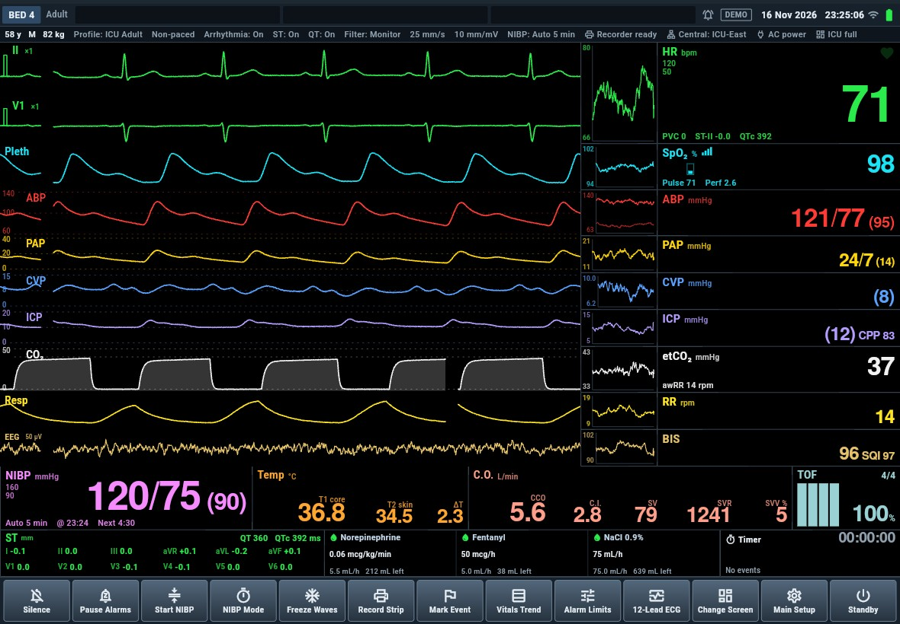

# Vital Signs Monitor

A Flutter app that looks and behaves like a bedside patient monitor. It started as a prop for a doll
hospital and is now aimed at cosplay and film props: sweeping traces, real rhythm morphology, working
on-screen keys, alarms that behave the way monitor alarms do.

**It is a simulation.** Nothing on screen is measured from anyone, and it must never be used to assess
or treat a person. The app says so on its start-up screen.



## Running it

```
flutter pub get
flutter run            # phone / tablet in landscape, macOS, or -d chrome
```

Settings (bed label, patient name, which waves are shown, volumes) are saved between launches.

## The hidden control panel

Nothing on the monitor hints at it:

- **Touch screens:** long-press the clock in the top bar.
- **Keyboard:** press `H` (or the backquote key). `Esc` closes it.

| Tab | What it does |
| --- | --- |
| Rhythm | 46 rhythms in nine groups, with a rate slider where the rhythm allows one |
| Vitals | SpO₂, blood pressure, respiratory rate, etCO₂, temperature, airway obstruction, CVP, PA pressure, ICP, sedation (BIS), paralysis (TOF), breathing mode, PEA |
| Scenarios | Scripted sequences that play out on their own (list below) |
| Events | One-off PVC / couplet / run of VT, shock, CPR, motion artifact, leads off, probe off |

### Scenarios

Stable patient · Chest pain to cardiac arrest (STEMI → VT → VF → CPR → two shocks → ROSC) · Flatline ·
SVT and adenosine · Rapid A-fib · Severe asthma · Opioid overdose · Septic shock · Hemorrhagic shock ·
Heart block and pacing · Head injury (rising ICP, Cushing response) · Just ran up the stairs

## Screens

The **Change Screen** key switches between five layouts:

| Screen | Shows |
| --- | --- |
| ICU full (default) | Ten traces (two ECG leads, pleth, ABP, PAP, CVP, ICP, CO₂, respiration, EEG), a mini-trend and a numeric beside each, then two lower rows: NIBP, core and skin temperature, cardiac output, train-of-four, ST for all twelve leads with QT/QTc, infusion pumps, and a timer |
| Standard | Only the traces switched on in Main Setup |
| Big numbers | One ECG trace and six large numerics |
| Graphical trends | The last hour of HR, SpO₂, ABP, etCO₂ and awRR as graphs |
| ST and events | ST map for the twelve leads and the alarm and event history |

Above the traces there is an alarm lamp across the top edge, the alarm message bar, and an information
line (patient details, profile, filter, sweep speed, recorder and network state).

## What the on-screen keys do

| Key | Action |
| --- | --- |
| Silence | Acknowledges the alarms that are sounding; the messages stay until the cause clears |
| Pause Alarms | Suspends all alarms for two minutes, with a countdown in the top bar |
| Start NIBP | Runs a cuff cycle: inflate, step down, result (or a failed reading if there is no pulse) |
| NIBP Mode | Manual, or automatic every 1 to 30 minutes |
| Freeze Waves | Holds the traces; the numbers keep updating |
| Record Strip | "Prints" six seconds of the first ECG lead on paper-grid strip and logs it |
| Mark Event | Adds a time-stamped entry to the event history |
| Vitals Trend | Minute-by-minute table of the numerics and cuff readings |
| Alarm Limits | Low and high limits for each parameter |
| 12-Lead ECG | All twelve leads, live |
| Change Screen | Picks one of the five layouts above |
| Main Setup | Patient name, bed label, leads, trace size, sweep speed, optional waves, volumes, °C / °F |
| Standby | Suspends monitoring until the screen is touched |

Touching an ECG trace picks its lead. Touching a numeric opens its alarm limits; touching NIBP starts a
reading; touching the timer starts or stops it (hold to reset). On a narrow screen the keys that do not
fit sit behind a More key.

## How it works

`lib/sim/` is a small patient model with no Flutter UI in it:

- `ecg_engine.dart` schedules beats and sums them into eight independent leads (I, II, V1 to V6); the
  other four limb leads are derived, so all twelve agree with each other.
- `ecg_shapes.dart` holds the beat morphologies; `rhythms.dart` is the rhythm list.
- `patient_sim.dart` turns beats into pulses, pulses into the pleth and arterial traces, and measures the
  displayed numbers back off those traces. That is why a PVC shows as a weak pulse, why HR and pulse
  rate can disagree, and why the pressure sags in fast or irregular rhythms.
- The other measurements hang off the same circulation: PA pressure follows the arterial pulse, CVP has
  a, c and v waves around each beat and climbs in arrest, the ICP pulse changes shape as pressure
  rises, cardiac output comes from pulse pressure and rate, and the EEG flattens when blood flow stops.
- `scenarios.dart` is the scripted sequences. Adding one is a list of timed steps.

The waveforms are synthesised from those models. They are not recordings of real patients.

`lib/ui/` draws the monitor. Traces use an erase-bar sweep at a true 25 mm/s (6.25 mm/s for CO₂ and
respiration) instead of scrolling.

Tones live in `assets/sounds/` and are generated by `python3 tool/make_sounds.py`. The pulse tone drops
in pitch as SpO₂ falls.

## Tests

```
flutter test                                              # simulation and UI checks
flutter test --update-goldens test/screens_test.dart      # renders screenshots into test/goldens/
```
